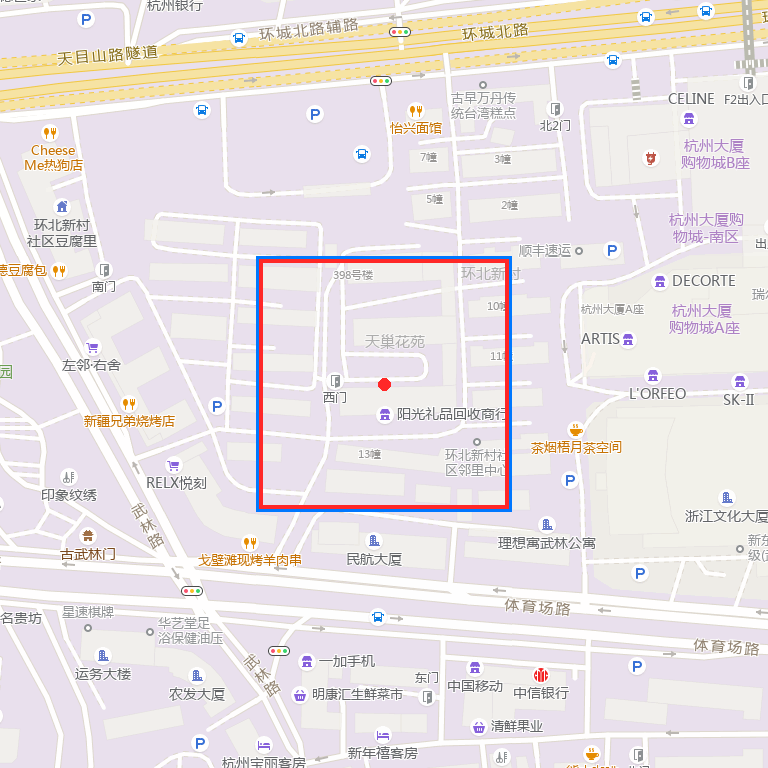

# Spatial Map Foundation

[](LICENSE)
[](https://isocpp.org/)

> 哈希瓦片地图底座 + 空间状态运行时：把局部 SLAM 增量状态嵌入城市级地图坐标，并以版本化状态事务管理地图状态。
>
> A hash-tiled map foundation and spatial-state runtime for versioned map transactions.

## 项目状态

| 项目 | 状态 |
| --- | --- |
| 维护状态 | Active |
| 实现范围 | C++20；哈希瓦片、地理锚定、语义地图和状态事务 |
| 主要验证 | 单元测试、地图状态 demo、底图对齐与可视化工具 |
| 生产集成 | 上游 SLAM、规划和真机链路通过接口接入 |

## 项目简介

地图是导航的度量底座。项目将 Super-LIO 风格的局部 ENU 位姿经过地理锚定和坐标转换，登记到 WGS84 / GCJ-02 / XYZ 瓦片，再通过空间状态运行时形成可查询、可持久化的版本化快照。

```text
局部 ENU 位姿 → WGS84 → GCJ-02 / XYZ z/x/y
             → 哈希瓦片登记 → SubmapPose 状态
             → 空间状态事务 → 版本化状态快照
```

## 核心能力

- 经纬度与高德 / XYZ / Slippy Map 瓦片 `z/x/y` 互转。
- 固定容量开放寻址哈希表、幂等登记、重复拒绝和墓碑删除。
- 局部 ENU 位姿与地图原点经纬度 / 航向的地理锚定。
- WGS84 ↔ GCJ-02 转换和高德瓦片 URL 构造。
- 状态生命周期、因子批次校验、原子事务和固定延迟窗口。
- 语义瓦片、`map_version` 追踪、只读查询服务和 ScenePack v1。
- Gaussian Splatting 数据模型与 3DGS PLY 导出。
- 语义地图可视化、标签回写和组合演示。

## 快速开始

要求：CMake 3.20+ 或支持 C++20 的编译器。

```bash
cmake -S . -B build
cmake --build build
ctest --test-dir build --output-on-failure
./build/map_state_demo
```

验证底图对齐：

```bash
./tools/fetch_amap_tile.sh 30.2740 120.1550 18 amap_tile.png
```

导出并查看代理 splat：

```bash
./build/export_splats 30.2740 120.1550 18 splats.ply
python3 tools/visualize_tiles.py 30.2740 120.1550 18 docs/assets/map_3x3.png
```

## Demo 展示

### 高德底图与 splat 瓦片叠加



蓝框为中心瓦片；红框和红点为已登记 splat 瓦片。

### 终端全链路回放

```text
== Super-LIO 增量位姿 → 哈希瓦片 → 空间状态事务 ==
[+ok] 局部位姿 → WGS84 → z/x/y → graph_version=1
[dup] 已存在瓦片，拒绝重复登记
== 状态快照 ==
graph_version=3 active_states=3 tiles_registered=3 duplicates_rejected=1
```

### Gaussian Splatting 导出

`splats.ply` 位于 [docs/assets/splats.ply](docs/assets/splats.ply)，可拖入 [SuperSplat](https://superspl.at/editor) 交互查看。

## 目录结构

```text
src/map/        瓦片编码、存储、底图、语义瓦片和持久化
src/runtime/    状态事务、语义标签和查询服务
src/render/     Gaussian Splatting 数据模型
demo/           地图状态与语义楼层演示
tools/          拉瓦片、导出、合并和可视化工具
docs/assets/    演示资产
```

## 坐标与版本边界

- 机器人位姿查询使用 WGS84；服务端内部换算到瓦片的 GCJ-02 空间，不能混用。
- 语义瓦片和查询响应携带 `map_version`，消费方必须校验版本。
- `base` 地图文件只读不改，标签合并结果另存；版本不匹配的标注会被丢弃。
- 地图底座不替代 SLAM、规划器或厂商地图服务，生产部署仍需真实数据和系统辨识。

## 关联项目

- [ForkSpatial-Runtime-Engine](https://github.com/zxinyu-robot/ForkSpatial-Runtime-Engine)：空间状态运行时。
- [quadruped-crossfloor-nav-ws](https://github.com/zxinyu-robot/quadruped-crossfloor-nav-ws)：Go2 跨楼层导航案例。
- [swarm-adapter-foundation](https://github.com/zxinyu-robot/swarm-adapter-foundation)：多机状态和通信策略基础设施。

## 许可证

[MIT](LICENSE)
